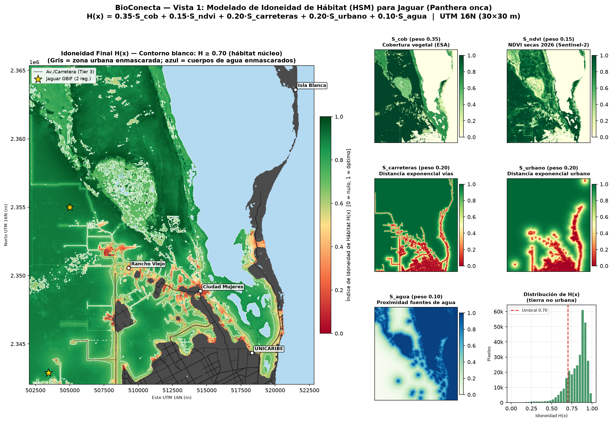
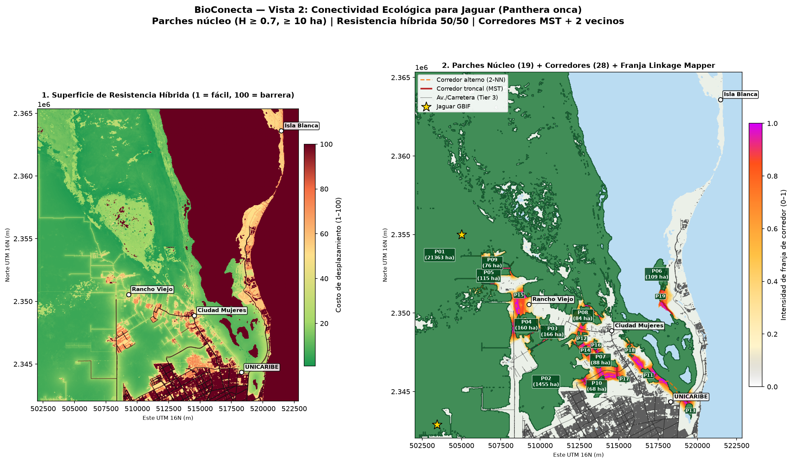
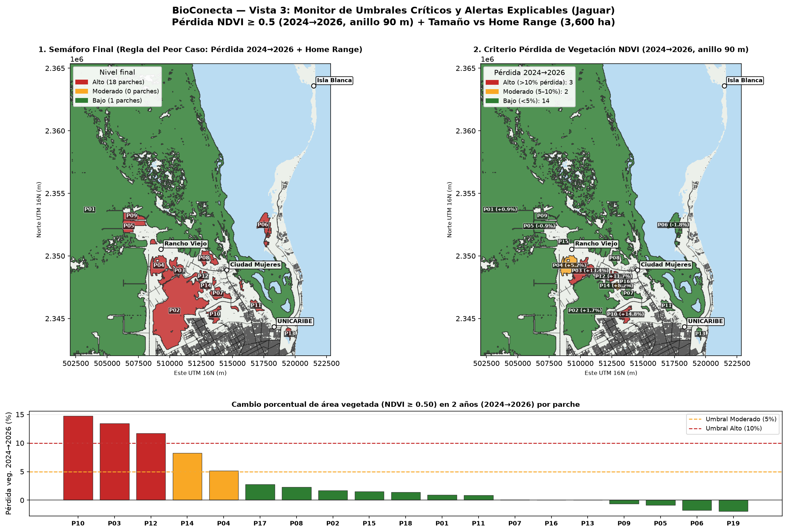
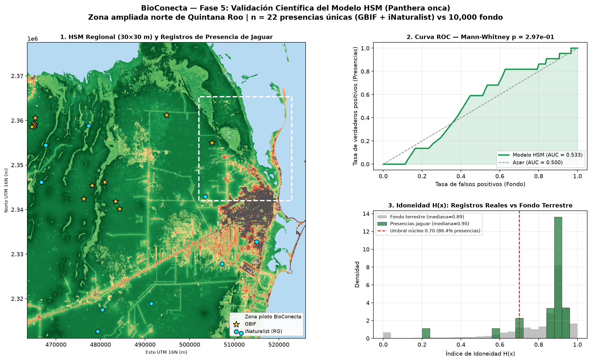

# 🐆 BioConecta

Sistema geoespacial de **Modelado de Idoneidad de Hábitat (HSM)**, **Conectividad Ecológica** y **Monitoreo de Umbrales Críticos con Alertas Tempranas** para el jaguar (*Panthera onca*) en la zona piloto **UNICARIBE – Rancho Viejo – Zona Continental de Isla Mujeres** (Quintana Roo, México).

---

## Enfoque del producto

1. **Vista 1 — Modelado de Idoneidad de Hábitat (HSM):** Evalúa la calidad del territorio (`0` a `1`) combinando cobertura vegetal (ESA WorldCover), vigor vegetal reciente (NDVI Sentinel-2 temporada seca 2026), distancia exponencial por jerarquía vial (OpenStreetMap), distancia a mancha urbana/turística y proximidad a fuentes de agua (incluyendo cenotes y humedales). Excluye matriz urbana consolidada, terrenos baldíos aislados y la franja hotelera costera.
2. **Vista 2 — Análisis de Conectividad Ecológica:** Extrae parches núcleo ($H \ge 0.70$, área $\ge 10\text{ ha}$), construye una superficie de resistencia híbrida 50/50 (tabla de costos + idoneidad invertida) y traza corredores de menor costo (*Dijkstra geométrico*, MST + 2 vecinos más cercanos) junto con franjas de corredor estilo *Linkage Mapper*.
3. **Vista 3 — Monitor de Umbrales Críticos y Alertas Explicables:** Mide la pérdida de área vegetada ($\text{NDVI} \ge 0.50$, temporada seca `2024 → 2025 → 2026`, parche + anillo de `90 m`) y compara el tamaño de cada parche contra el *home range* mínimo del jaguar (`3,600 ha`, telemetría en Calakmul — Chávez & Ceballos), emitiendo alertas transparentes bajo la regla del peor caso.
4. **Validación Científica:** Evalúa el modelo HSM con registros independientes de *Panthera onca* (GBIF + iNaturalist *Research Grade*) en el norte de Quintana Roo y muestra 8 registros documentados (oficiales, ciencia ciudadana, prensa/PROFEPA y atropellamiento en Av. Arco Norte) dentro de la zona piloto.

---

## Vista previa de resultados

| Vista 1: Idoneidad de Hábitat (HSM) | Vista 2: Conectividad Ecológica |
| :---: | :---: |
|  |  |

| Vista 3: Umbrales y Alertas (2024→2026) | Fase 5: Validación Científica |
| :---: | :---: |
|  |  |

---

## Ejecución rápida de la App Web

El repositorio incluye las capas precalculadas (`outputs/` y capas normalizadas `S_*.tif`), por lo que puedes lanzar la aplicación directamente sin descargar imágenes satelitales:

```bash
python3 -m venv .venv
source .venv/bin/activate
pip install -r requirements.txt
streamlit run app.py
```

### Funcionalidades de la app (`app.py`)
- **Pestaña 1 (Idoneidad):** mapa a ancho completo con 8 registros de jaguar diferenciados por categoría y botón **⚙️ Ajustes avanzados** con 5 sliders que recalculan $H(x)$ en vivo.
- **Pestaña 2 (Conectividad):** 19 parches núcleo, 28 corredores (MST + alternos), franja *Linkage Mapper* y tabla ordenable.
- **Pestaña 3 (Alertas):** semáforo interactivo (peor caso vs. solo pérdida NDVI `2024→2026`), ficha explicable al dar clic sobre cualquier parche con trayectoria `2024→2025→2026` y descarga en CSV.
- **Pestaña 4 (Validación):** métricas ROC-AUC, prueba de Mann-Whitney, mapa regional y tabla de registros.

---

## Reproducir el pipeline geoespacial desde cero

Todas las capas se proyectan a **UTM Zona 16N (`EPSG:32616`)** con resolución espacial de **30 × 30 m**:

```bash
python scripts/01_download_data.py        # ESA WorldCover 2020/2021, OSM vías y GBIF
python scripts/02_prepare_layers.py       # Recorte, reproyección UTM 16N y grilla 30x30 m
python scripts/01b_download_ndvi.py       # Sentinel-2 L2A NDVI (secas 2024-2026) + agua OSM
python scripts/01c_download_osm_anthro.py # Polígonos hoteleros/turísticos y urbanos OSM
python scripts/01d_build_pilot_sightings.py # Capa curada de 8 registros en zona piloto
python scripts/03_habitat_suitability.py  # Vista 1: HSM + capas S_* + filtro urbano/costero
python scripts/04_connectivity.py         # Vista 2: Parches, resistencia y corredores
python scripts/05_alerts.py               # Vista 3: Umbrales de pérdida y home range
python scripts/06_validation.py           # Fase 5: Validación regional GBIF + iNaturalist
```

---

## Estructura del proyecto

```text
BioCOnecta/
├── app.py                  # Aplicación web interactiva (Streamlit + Folium)
├── config.py               # AOI, CRS (EPSG:32616), resolución (30 m) y rutas
├── species_rules.py        # Parámetros ecológicos del jaguar, pesos y umbrales
├── requirements.txt        # Dependencias Python
├── scripts/                # Pipeline modular reproducible (pasos 01 a 06)
├── data/processed/         # Capas alineadas 30x30 m necesarias para la app
└── outputs/                # Rásteres finales, GeoJSON ligeros, mapas HTML y previews
```
