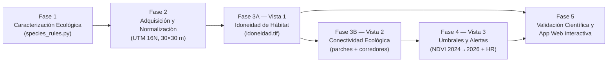

# BioConecta — Documentación Formal del Proyecto

**Sistema Geoespacial de Modelado de Idoneidad de Hábitat, Conectividad Ecológica y Alertas Tempranas de Fragmentación para el Jaguar (*Panthera onca*)**

- **Zona piloto:** UNICARIBE – Rancho Viejo – Zona Continental de Isla Mujeres, Quintana Roo, México
- **Especie focal:** Jaguar (*Panthera onca*) — *En Peligro de Extinción* (NOM-059-SEMARNAT-2010)
- **Aplicación web en vivo:** [bioconecta.streamlit.app](https://bioconecta.streamlit.app/)
- **Repositorio oficial:** [github.com/RyzenAGB/BioConecta](https://github.com/RyzenAGB/BioConecta)
- **Sistema de referencia espacial:** WGS 84 / UTM Zona 16N (`EPSG:32616`), resolución `30 × 30 m`

---

## 1. Resumen Ejecutivo — ¿De qué trata BioConecta?

**BioConecta** es una plataforma analítica y de visualización geoespacial diseñada para diagnosticar el estado actual del hábitat natural, identificar los corredores ecológicos críticos y emitir **alertas tempranas explicables** cuando un fragmento de selva o manglar pierde vegetación aceleradamente o cae por debajo de la superficie mínima vital (*home range*) que requiere una especie focal para sobrevivir.

A diferencia de los mapas temáticos estáticos o de los modelos ecológicos de "caja negra" que requieren software GIS especializado (como ArcGIS o QGIS) para interpretarse, BioConecta integra datos satelitales abiertos y actualizados (**Sentinel-2 2024–2026**, **ESA WorldCover**, **OpenStreetMap**, **GBIF** e **iNaturalist**) en un flujo reproducible en Python que alimenta una aplicación web interactiva (**Streamlit + Folium**) estructurada en cuatro módulos:

1. **Modelado de Idoneidad de Hábitat (HSM):** mapa continuo (`0` a `1`) que identifica qué zonas del territorio ofrecen condiciones reales de vegetación, vigor fotosintético, acceso a agua y baja perturbación humana para el jaguar, excluyendo matriz urbana consolidada, terrenos baldíos y la franja hotelera costera.
2. **Análisis de Conectividad Ecológica:** delimitación automática de parches núcleo de hábitat y trazado de los corredores de desplazamiento de menor costo que los unen, destacando cuellos de botella críticos.
3. **Monitor de Umbrales Críticos y Alertas Explicables:** evaluación multitemporal (`2024 → 2025 → 2026`) de cada parche frente a umbrales cuantitativos de pérdida vegetal y área mínima vital, clasificando el riesgo en un semáforo transparente con justificación textual automática.
4. **Validación Científica:** contraste cuantitativo de las predicciones espaciales contra registros reales de presencia de jaguar (oficiales, de ciencia ciudadana y reportes documentados en la frontera urbana).

---

## 2. Planteamiento del Problema

La periferia norte de Cancún y la Zona Continental de Isla Mujeres —en el corredor geográfico que conecta la **Universidad del Caribe (UNICARIBE)**, **Ciudad Mujeres**, **Rancho Viejo** y el Área Natural Protegida estatal **Sistema Lagunar Chacmuchuch**— experimenta una de las tasas de transformación territorial más aceleradas del sureste mexicano.

Esta expansión urbana, inmobiliaria, vial y turística produce cuatro problemáticas críticas e interrelacionadas:

1. **Fragmentación acelerada de selva mediana y manglares:** la apertura de fraccionamientos, asentamientos irregulares y brechas de terracería divide la selva continua en fragmentos cada vez más pequeños y aislados, incapaces por sí solos de sostener a depredadores tope con amplios requerimientos espaciales.
2. **Efecto barrera y mortalidad vial:** arterias periféricas como la **Avenida Arco Norte** y las vías de conexión hacia Ciudad Mujeres y Rancho Viejo interrumpen las rutas naturales de desplazamiento de fauna silvestre. Como evidencia documentada, el **13 de febrero de 2022** se registró el atropellamiento fatal de una cría de jaguar sobre Av. Arco Norte a la altura de la Universidad Politécnica de Quintana Roo (caso turnado a PROFEPA y CONANP).
3. **Aumento del conflicto humano–fauna silvestre:** la pérdida directa de hábitat en el borde selvático ha provocado incursiones recientes y reiteradas de jaguares en zonas habitacionales del norte de Cancún —documentadas en febrero, mayo y junio de 2024 en fraccionamientos como **Villas del Mar (SM 248)**, **Alôja** y asentamientos colindantes con **Av. Arco Norte**—, poniendo en riesgo tanto a los ejemplares como a la seguridad y percepción de las comunidades locales.
4. **Brecha de información oportuna y accionable:** los inventarios oficiales de uso de suelo suelen actualizarse con varios años de rezago y carecen de un mecanismo automatizado que traduzca imágenes satelitales recientes en alertas claras sobre *qué parches concretos están perdiendo cobertura hoy* y *qué corredores deben protegerse primero*.

---

## 3. Justificación

El desarrollo de BioConecta se justifica desde cuatro dimensiones complementarias:

- **Relevancia ecológica (especie paraguas):** el jaguar (*Panthera onca*) es el mayor felino de América, se encuentra catalogado **En Peligro de Extinción** en la norma mexicana **NOM-059-SEMARNAT-2010** y funciona como *especie paraguas* y reguladora trófica. Proteger los bloques de selva y corredores necesarios para el desplazamiento del jaguar protege de forma simultánea el hábitat de decenas de especies regionales (como venado temazate, pecarí, mono araña, coatí y aves residentes) y preserva servicios ecosistémicos clave como la recarga del acuífero kárstico y la protección costera del manglar.
- **Pertinencia territorial:** el recuadro piloto (`48,461.5 ha`) abarca exactamente la zona de fricción crítica entre la mancha urbana norte de Cancún, el macizo selvático occidental y el refugio estatal de flora y fauna **Sistema Lagunar Chacmuchuch**, constituyendo un laboratorio vivo de alto valor académico e institucional junto a la **Universidad del Caribe**.
- **Explicabilidad para la toma de decisiones:** en planeación territorial, ordenamiento ecológico y gestión ambiental municipal/estatal, los tomadores de decisiones requieren reglas auditablemente transparentes. BioConecta evita métricas opacas: cada alerta indica exactamente cuántas hectáreas se perdieron entre 2024 y 2026, qué porcentaje del *home range* representa el parche y por qué se activó el nivel de riesgo.
- **Sostenibilidad técnica y accesibilidad:** toda la arquitectura se apoya en **datos satelitales y cartográficos 100% abiertos** (sin costos de licenciamiento ni APIs de pago) y software libre en Python, lo que permite replicar el sistema en otros municipios de Quintana Roo o ampliarlo a nuevas especies focales con un esfuerzo mínimo.

---

## 4. Objetivos

### Objetivo General
Desarrollar e implementar un sistema geoespacial reproducible e interactivo que modele la idoneidad de hábitat, identifique corredores de conectividad ecológica y genere alertas tempranas explicables por pérdida de cobertura y fragmentación para el jaguar (*Panthera onca*) en la zona piloto UNICARIBE – Rancho Viejo – Zona Continental de Isla Mujeres.

### Objetivos Específicos
1. **Caracterizar ecológicamente** a la especie focal (*Panthera onca*) con base en literatura científica regional, traduciendo sus requerimientos de hábitat, tolerancia a perturbación y área mínima vital en parámetros cuantitativos auditablemente documentados.
2. **Adquirir, depurar y homologar** capas geoespaciales abiertas (cobertura del suelo, series multitemporales de NDVI Sentinel-2 2024–2026, red vial jerarquizada, infraestructura turística/urbana, fuentes de agua y registros de presencia) a un sistema métrico común (`EPSG:32616`, `30 × 30 m`).
3. **Generar los modelos espaciales base** de idoneidad de hábitat (HSM) y conectividad ecológica (parches núcleo, superficie de resistencia híbrida, corredores de menor costo y franjas de conectividad).
4. **Implementar un motor de umbrales críticos y alertas** que compare cada parche contra su evolución vegetal reciente (`2024 → 2026`) y el *home range* de referencia (`3,600 ha`), generando diagnósticos textuales explicables.
5. **Validar científicamente** el modelo espacial contra registros reales de presencia (GBIF e iNaturalist) y **exponer todos los resultados** en una aplicación web interactiva accesible sin software GIS.

---

## 5. Información y Fuentes de Datos

Todas las capas utilizadas en BioConecta provienen de fuentes abiertas y verificables. En el cuadro siguiente se resume el inventario completo de información recopilada y procesada:

| Capa / Recurso | Fuente abierta | Cobertura temporal | Resolución / Tipo | Uso en el sistema |
| :--- | :--- | :--- | :--- | :--- |
| **Cobertura del suelo** | ESA WorldCover (`v100` y `v200`, cuadrante `N21W087`; más `N21W090`, `N18W087`, `N18W090` para validación regional) | 2020 y 2021 | Ráster `10 m` → remuestreado por moda a `30 m` | Puntaje de cobertura ($S_{cob}$), extracción de mancha urbana (clase `50`), cuerpos de agua (`80`), humedales (`90`) y tabla base de resistencia |
| **Índices de vigor vegetal (NDVI)** | Sentinel-2 L2A (catálogo STAC Earth Search / AWS, cuadrante MGRS `16QEJ`; `16QDJ`+`16QEJ` en regional) | Temporada seca (marzo–mayo) **2024, 2025 y 2026** | `8` escenas limpias/año (`< 15%` nubes), enmascarado SCL, calculado a `10 m` y promediado a `30 m` | Calidad actual de vegetación ($S_{ndvi}$, 2026) y detección multitemporal de deforestación (`2024 → 2025 → 2026`) en Vista 3 |
| **Red vial jerarquizada** | OpenStreetMap (Overpass API) | Actualizada (2026) | Vector `4,970` segmentos en zona piloto (`23,890` en regional) → rasterizado a `30 m` | Clasificada en 3 niveles: Tier 1 terracería (`616`), Tier 2 calle local (`3,903`), Tier 3 avenida/carretera (`451`) para $S_{carreteras}$ y resistencia |
| **Infraestructura turística y urbana reciente** | OpenStreetMap (Overpass API: `tourism=hotel/resort`, `leisure=golf_course/marina`, `landuse=residential/commercial/construction`, edificios costeros) | Actualizada (2026) | `330` polígonos (`481.7 ha`) → rasterizados a `30 m` | Complementa ESA 2021 en la franja hotelera de Playa Mujeres / Costa Mujeres y desarrollos 2022–2026 ($S_{urbano}$ y exclusión) |
| **Fuentes de agua y cenotes** | ESA WorldCover (clases `80` y `90`) + OpenStreetMap (`natural=water/spring/sinkhole`, `water=*`, `waterway=river/stream`) | 2021–2026 | `38` elementos OSM (`+1,237` píxeles nuevos fuera de ESA) → ráster binario `30 m` | Cálculo de proximidad al agua ($S_{agua}$), incorporando cenotes y aguadas pequeñas que ESA no detecta |
| **Registros de presencia de jaguar** | GBIF (`Panthera onca`) + iNaturalist API (*Research Grade* y grado casual) + hemerografía/reportes 911–PROFEPA | 1878–2026 (`22` registros únicos en regional; `8` documentados en zona piloto) | Puntos georreferenciados (GeoJSON) | Validación cuantitativa regional (ROC-AUC / Mann-Whitney) y contextualización de conflictos en zona piloto |

### Notas técnicas de calidad de datos
- **Armonización radiométrica Sentinel-2:** durante la verificación de control de calidad se detectó que los GeoTIFF optimizados en la nube (COG) de Sentinel-2 L2A en Earth Search ya descuentan el desplazamiento radiométrico BOA de `-1000` (es decir, `reflectancia = DN × 0.0001`), aunque el metadato STAC conserve `offset = -0.1`. La corrección evitó la saturación artificial de la banda roja y produjo valores de NDVI físicamente consistentes (`mediana 2024 = 0.607`, `2025 = 0.531`, `2026 = 0.577`, con `0` a `157` píxeles sin dato sobre `538,461` totales).
- **Por qué no se usó ESA 2020 vs 2021 para medir deforestación:** las versiones `v100` (2020) y `v200` (2021) emplean algoritmos de clasificación distintos, generando artefactos interanuales que no reflejan cambios reales en el terreno. Por ello, la pérdida de vegetación en la Vista 3 se mide exclusivamente con compuestos homogéneos de mediana **NDVI Sentinel-2 (2024 → 2026)** bajo las mismas condiciones fenológicas de temporada seca.

---

## 6. Metodología Híbrida de 5 Fases

El proyecto adopta una **metodología híbrida de 5 fases**, inspirada en el estándar de ciencia de datos **CRISP-DM** (*Cross-Industry Standard Process for Data Mining*) adaptado al análisis geoespacial y la ecología del paisaje:

---

### Fase 1 — Caracterización Ecológica (Definición de Reglas)

Se consolidaron los requerimientos biológicos del jaguar (*Panthera onca*) en el módulo [species_rules.py](../species_rules.py):

- **Área mínima vital (*home range*):** **`3,600 ha` (`36 km²`)**, correspondiente a la estimación base obtenida mediante telemetría en selva tropical de la Península de Yucatán (Reserva de la Biosfera de Calakmul; Chávez y Ceballos, quienes reportan estimaciones base de `36–56 km²`, con rangos extendidos mayores en seguimiento GPS de largo plazo).
- **Preferencia por tipo de cobertura ($S_{cob}$):**

| Clase ESA WorldCover | Código | Puntaje $S_{cob}$ | Costo base de resistencia |
| :--- | :---: | :---: | :---: |
| Selva / Cobertura arbórea | `10` | `1.0` | `1` |
| Manglar | `95` | `0.7` | `5` |
| Humedal herbáceo | `90` | `0.5` | `10` |
| Matorral | `20` | `0.5` | `15` |
| Pastizal | `30` | `0.3` | `15` |
| Cultivos | `40` | `0.2` | `30` |
| Suelo desnudo / escasa veg. | `60` | `0.1` | `40` |
| Zona urbana / construida | `50` | `0.0` (enmascarado) | `100` |
| Cuerpos de agua permanentes | `80` | `0.0` (enmascarado) | `100` |

- **Costos viales adicionales en resistencia:** terracería/brecha (Tier 1) = `20`, calle local (Tier 2) = `50`, avenida/carretera pavimentada (Tier 3) = `80`.
- **Tolerancia espacial a perturbación humana y dependencia hídrica:**
  - Avenidas/carreteras (Tier 3): el puntaje alcanza $\approx 0.95$ a `1,000 m` ($k = 333.3\text{ m}$).
  - Calles locales (Tier 2): alcanza $\approx 0.95$ a `500 m` ($k = 166.7\text{ m}$).
  - Terracerías/brechas (Tier 1): alcanza $\approx 0.95$ a `250 m` ($k = 83.3\text{ m}$).
  - Mancha urbana y desarrollos turísticos: alcanza $\approx 0.95$ a `2,000 m` ($k = 666.7\text{ m}$).
  - Fuentes de agua (relación inversa — estar cerca es favorable): puntaje `1.0` junto al agua, decayendo exponencialmente hasta $\approx 0.05$ a `3,000 m` ($k = 1,000\text{ m}$).

---

### Fase 2 — Adquisición y Normalización de Datos

Implementada en `scripts/01_download_data.py`, `01b_download_ndvi.py`, `01c_download_osm_anthro.py`, `01d_build_pilot_sightings.py` y `02_prepare_layers.py`:

1. **Definición del área piloto (AOI):** recuadro geográfico `lon [-86.98°, -86.78°]`, `lat [21.18°, 21.39°]`, reproyectado a **UTM Zona 16N (`EPSG:32616`)** y ajustado a múltiplos exactos de `30 m`.
2. **Cuadrícula canónica:** **`693` columnas × `777` filas** (`538,461` píxeles de `30 × 30 m` = `0.09 ha/píxel`, cubriendo exactamente **`48,461.5 ha`**).
3. **Homologación estricta:** todos los rásteres (`landcover`, `urban`, `roads`, `water_sources`, `osm_anthro`, `ndvi_2024/2025/2026`) comparten idéntica proyección, extensión, matriz afín y tamaño de píxel. Las variables categóricas se remuestrearon por **moda** y las continuas (NDVI) por **promedio** de bloques `3 × 3` desde `10 m`.

---

### Fase 3 — Modelado Espacial (Hábitat y Corredores)

#### 3.1 Vista 1 — Modelado de Idoneidad de Hábitat (`03_habitat_suitability.py`)

Cada variable se normaliza al intervalo $[0, 1]$:

- **Cobertura vegetal:** $S_{cob}(x)$ según la tabla ecológica de la Fase 1 sobre ESA WorldCover 2021.
- **Vigor vegetal actual (NDVI 2026):** reescalado lineal acotado entre `0.2` y `0.8`:

$$S_{ndvi}(x) = \operatorname{clip}\!\left(\frac{\text{NDVI}_{2026}(x) - 0.2}{0.8 - 0.2},\; 0,\; 1\right)$$

- **Distancia a red vial (jerarquizada):** se calcula la distancia euclidiana en metros mediante transformada exacta (`scipy.ndimage.distance_transform_edt`) por separado para cada jerarquía $t \in \{1, 2, 3\}$, aplicando la curva exponencial y conservando el mínimo (prevalece la vía más perturbadora cercana):

$$S_{carreteras}(x) = \min_{t \in \{1,2,3\}} \left(1 - e^{-d_t(x) / k_t}\right)$$

- **Distancia a zona urbana y desarrollos turísticos:** combinando ESA clase `50` y los `330` polígonos turísticos/urbanos de OSM:

$$S_{urbano}(x) = 1 - e^{-d_{urb}(x) / 666.67}$$

- **Proximidad a fuentes de agua:** combinando agua permanente (ESA `80`), humedales (ESA `90`) y cenotes/lagunas/corrientes OSM:

$$S_{agua}(x) = e^{-d_{agua}(x) / 1000}$$

- **Combinación lineal ponderada:**

$$H(x) = 0.35\,S_{cob}(x) + 0.15\,S_{ndvi}(x) + 0.20\,S_{carreteras}(x) + 0.20\,S_{urbano}(x) + 0.10\,S_{agua}(x)$$

- **Máscara de exclusión ecológica (matriz urbana, baldíos y franja hotelera):** para evitar que lotes baldíos rodeados de calles pavimentadas o la estrecha barra hotelera costera de Costa Mujeres / Isla Blanca generen falsos positivos de hábitat para el jaguar, se fuerza $H(x) = 0$ en:
  1. Cuerpos de agua permanentes (ESA `80`) y superficie urbana/turística directa (ESA `50` + polígonos OSM de hoteles, resorts, campos de golf y desarrollos).
  2. **Matriz urbana/turística consolidada:** píxeles cuya vecindad circular de `300 m` presenta $\ge 35\%$ de cobertura construida, resorts o calles pavimentadas (Tier 2 y 3).
  3. **Enclaves o barras costeras aisladas $< 500\text{ ha}$ (`< 14%` del *home range*):** bloques terrestres completamente desconectados del macizo continental por agua y matriz urbana/hotelera. Este filtro removió objetivamente `33` enclaves/barras (`2,548.8 ha` de ruido urbano/costero).

#### 3.2 Vista 2 — Análisis de Conectividad Ecológica (`04_connectivity.py`)

1. **Extracción de parches núcleo:** se filtran los píxeles con $H(x) \ge 0.70$, se agrupan mediante conectividad de **8 vecinos** (`skimage.measure.label`), se descartan fragmentos menores a **`10 ha`** y se vectorizan en `outputs/parches.geojson`, registrando área en hectáreas, idoneidad media, cobertura dominante y la bandera de control **`toca_borde`** (efecto de borde del recuadro de estudio).
2. **Superficie de resistencia híbrida (50/50, escala `1` a `100`):**

$$R(x) = 0.50 \cdot C_{\text{tabla}}(x) + 0.50 \cdot \bigl(1 + 99\,(1 - H(x))\bigr)$$

   donde $C_{\text{tabla}}(x) = \max(C_{\text{cobertura}}(x),\, C_{\text{vial}}(x))$.
3. **Matriz de costo y selección de enlaces:** se ejecuta el algoritmo de camino de menor costo geométrico (**Dijkstra geométrico**, `skimage.graph.MCP_Geometric` con paso de `30 m` y conectividad de 8 direcciones) desde todos los píxeles de cada parche hacia todos los demás (midiendo siempre de **borde interior a borde interior**, evitando distorsiones por centroides). Con la matriz simetrizada de distancia ponderada por costo se construye el **Árbol de Expansión Mínima (MST)** y se agregan los **2 vecinos más cercanos** por costo de cada parche para capturar redundancia estructural sin saturar el mapa.
4. **Franja de corredor estilo *Linkage Mapper*:** para cada par $(i, j)$ seleccionado se calcula el costo excedente $E_{ij}(x) = CD_i(x) + CD_j(x) - \min(CD_{ij})$, normalizado a intensidad $[0, 1]$ hasta un umbral adaptable y combinado en el ráster `outputs/corredores_franja.tif`.

---

### Fase 4 — Cálculo de Umbrales Críticos y Motor de Alertas (`05_alerts.py`)

Para cada uno de los parches núcleo se evalúan dos criterios cuantitativos independientes:

1. **Pérdida de cobertura vegetal reciente (`2024 → 2026`, con punto intermedio `2025`):**
   - Se mide la superficie con vegetación fotosintéticamente densa ($\text{NDVI} \ge 0.50$) dentro del parche **más un anillo perimetral de `90 m`** (3 píxeles, excluyendo otros parches y agua permanente), con el fin de detectar desmonte activo en los bordes que ya quedaron fuera del contorno actual.
   - Se aplica la tasa de pérdida porcentual acumulada en 2 años:

$$P = \frac{A_{2024} - A_{2026}}{A_{2024}} \times 100$$

   - **Semáforo por pérdida:** `< 5%` = **Bajo** · `5% a 10%` = **Moderado** · `> 10%` = **Alto**.
2. **Viabilidad por tamaño frente al *home range* del jaguar (`3,600 ha`):**
   - **Semáforo por tamaño:** $\ge 100\%$ ($\ge 3,600\text{ ha}$) = **Bajo** · `50% a < 100%` (`1,800–3,600 ha`) = **Moderado** · `< 50%` (`< 1,800 ha`) = **Alto**.
3. **Combinación por regla del peor caso y explicabilidad:** el nivel final de alerta corresponde al mayor nivel activado entre ambos criterios, generando automáticamente el atributo textual `motivo` con todos los umbrales activados. Si el parche toca el límite del recuadro (`toca_borde = True`), el motor añade explícitamente la advertencia: *"El parche continúa fuera de la zona de estudio; su área puede estar subestimada."*

---

### Fase 5 — Validación Científica y Visualización Interactiva

#### 5.1 Validación científica (`06_validation.py`)
Dado que el recuadro piloto solo contiene `2` registros oficiales de *Panthera onca* en GBIF, se ejecutó exactamente el mismo pipeline HSM (`30 × 30 m`, UTM 16N) sobre un **recuadro regional ampliado** del norte de Quintana Roo (`lon [-87.35°, -86.75°]`, `lat [20.90°, 21.50°]`, mosaico de `2,081 × 2,215` píxeles) exclusivamente para evaluación estadística:
- Se compilaron `62` registros brutos (`45` de GBIF + `17` de iNaturalist *Research Grade*).
- Se descartaron `19` registros con incertidumbre posicional `> 5,000 m`, se deduplicaron registros a `< 100 m` y se excluyó `1` punto sobre agua, obteniendo **`22` presencias independientes**.
- Se contrastó $H(x)$ en las `22` presencias frente a **`10,000` puntos de fondo terrestres aleatorios** mediante curva **ROC-AUC**, prueba no paramétrica de **Mann-Whitney U** y porcentaje de acierto dentro del hábitat núcleo ($H \ge 0.70$).

Adicionalmente, para enriquecer el contexto territorial del prototipo piloto sin mezclar datos oficiales con extraoficiales, se construyó la capa `avistamientos_jaguar_piloto.geojson` con **`8` registros verificables** dentro del AOI piloto (`2` oficiales GBIF/CONABIO, `2` ciencia ciudadana iNaturalist grado casual, `3` reportes de prensa/911–PROFEPA en 2024 y `1` atropellamiento documentado en Av. Arco Norte en 2022).

#### 5.2 Arquitectura de visualización web (`app.py`)
Para evitar bloqueos durante demostraciones en vivo, el sistema sigue una arquitectura **híbrida offline → web**:
- **Cálculo pesado offline (Python):** genera `idoneidad.tif`, las 5 capas normalizadas `S_*.tif`, `parches.geojson`, `corredores.geojson`, `corredores_franja.tif`, `alertas_parches.geojson` y `validacion.json`.
- **Interfaz ligera en tiempo real (Streamlit + Folium):** carga en caché las capas ligeras y ofrece un diseño centrado en el mapa con **5 sliders de pesos en vivo** (dentro de `⚙️ Ajustes avanzados`, recalculando $H(x)$ en `< 50 ms` con NumPy), visualización de parches y corredores, **ficha explicable interactiva al dar clic en cualquier parche** con gráfica de trayectoria `2024 → 2025 → 2026`, descarga en CSV y pestaña dedicada de validación.

---

## 7. Resultados Principales

### 7.1 Idoneidad de Hábitat (Vista 1)
- **Superficie terrestre evaluada (excluyendo agua, matriz urbana y barra hotelera):** `28,861.6 ha` (tras remover `2,548.8 ha` de lotes baldíos urbanos y zona hotelera costera).
- **Alta idoneidad ($H \ge 0.70$):** **`24,007.5 ha`** (`83.2%`), concentrada en el macizo selvático occidental y el Sistema Lagunar Chacmuchuch.
- **Media idoneidad ($0.40 \le H < 0.70$):** **`4,323.2 ha`** (`15.0%`), correspondiente a la franja de amortiguamiento en Rancho Viejo y Ciudad Mujeres.
- **Baja idoneidad ($H < 0.40$):** **`530.9 ha`** (`1.8%`), en los frentes de mayor presión vial y urbana.

### 7.2 Conectividad Ecológica (Vista 2)
- Se identificaron **`19` parches núcleo** que suman **`23,867.1 ha`**:
  - **`P01` (`21,362.7 ha`, `toca_borde = Sí`):** el gran macizo continuo de selva al oeste y norte.
  - **`P02` (`1,454.8 ha`):** bloque crítico entre Rancho Viejo, Ciudad Mujeres y Av. Arco Norte, ya separado del macizo principal por brechas y asentamientos.
  - **`P03` a `P19` (`11.4` a `165.6 ha`):** fragmentos satélite de selva y manglar (como `P06` con `109.2 ha` de manglar en Chacmuchuch).
- Se trazaron **`28` corredores de menor costo** (`18` troncales MST + `10` enlaces alternos 2-NN), con longitud media de **`0.49 km`** y resistencia media de **`22.0 / 100`**, evidenciando cuellos de botella prioritarios en **Rancho Viejo (`P01 ↔ P05/P15/P04/P03/P02`)** y en el borde norte de **Ciudad Mujeres – UNICARIBE**.

### 7.3 Monitor de Umbrales y Alertas (Vista 3, `2024 → 2026`)
- **Semáforo final (peor caso):** **`18` parches en Alto** y **`1` parche en Bajo (`P01`)**. Que 18 de 19 fragmentos estén por debajo del `50%` del *home range* (`1,800 ha`) demuestra cuantitativamente que ningún fragmento aislado de la frontera urbana puede sostener al jaguar sin mantener activos los corredores hacia `P01`.
- **Focos de pérdida activa de vegetación (`NDVI ≥ 0.50`, `2024 → 2026`):** **`3` parches en alerta Alta (`> 10%`)** y **`2` en Moderada (`5–10%`)**, todos ubicados en el frente activo **Rancho Viejo – Ciudad Mujeres – Cancún Norte**:

| Parche | Área núcleo (ha) | % Home Range | Veg. 2024 (ha) | Veg. 2025 (ha) | Veg. 2026 (ha) | Pérdida 24→26 | Nivel pérdida | Alerta final |
| :--- | ---: | ---: | ---: | ---: | ---: | ---: | :---: | :---: |
| **P10** | 68.0 | 1.9% | 114.7 | 94.5 | 97.7 | **+14.8%** | 🔴 Alto | 🔴 Alto |
| **P03** | 165.6 | 4.6% | 235.3 | 212.2 | 203.7 | **+13.4%** | 🔴 Alto | 🔴 Alto |
| **P12** | 25.6 | 0.7% | 47.8 | 42.9 | 42.2 | **+11.7%** | 🔴 Alto | 🔴 Alto |
| **P14** | 24.5 | 0.7% | 40.4 | 38.2 | 37.1 | **+8.2%** | 🟠 Moderado | 🔴 Alto |
| **P04** | 159.8 | 4.4% | 210.8 | 199.9 | 199.9 | **+5.2%** | 🟠 Moderado | 🔴 Alto |

### 7.4 Validación Científica (Fase 5)
- **Precisión en hábitat núcleo:** el **`86.4%`** de las presencias reales de jaguar (`19` de `22`) cae dentro del hábitat núcleo predicho ($H \ge 0.70$), con una **idoneidad mediana de `0.899`** y una **distancia mediana al núcleo de `0 m`**. Dentro de la zona piloto, los `2` registros oficiales (1995 y 2024) obtuvieron **$H = 0.910$ y $H = 0.851$**.
- **Desempeño frente al fondo regional:** el **ROC-AUC** fue de **`0.5328`** (`Mann-Whitney p = 0.297`). Este valor se explica de manera transparente por dos factores reales: (1) en el recuadro regional ampliado hasta la Reserva El Edén, el **`82.1%`** del territorio terrestre sigue siendo selva continua apta (fondo mediano `0.887`), por lo que la clase positiva domina el paisaje; y (2) los registros ciudadanos de especies protegidas en iNaturalist presentan difuminado de coordenadas y sesgo hacia zonas cercanas a carreteras.
- **Coincidencia con conflictos reales:** los reportes de prensa/911 de 2024 (Villas del Mar, Alôja, Arco Norte) y el atropellamiento de 2022 (UPQROO) se concentran precisamente sobre el borde sur de `P02` y `P10`, coincidiendo con la frontera de mayor fragmentación y pérdida vegetal identificada por el modelo.

---

## 8. Limitaciones y Trabajo Futuro

1. **Efecto de borde:** el recuadro piloto corta el macizo occidental (`P01`); aunque el sistema señala automáticamente `toca_borde = True`, una fase posterior puede extender el análisis operativo a toda la cuenca norte de Quintana Roo (Benito Juárez, Isla Mujeres, Puerto Morelos y Lázaro Cárdenas).
2. **Desfase temporal de cobertura base:** ESA WorldCover corresponde a 2021; en BioConecta se mitigó incorporando **NDVI Sentinel-2 de 2026** y **polígonos actualizados de OpenStreetMap (2026)**, pero en el futuro puede integrarse clasificación supervisada anual directa sobre Sentinel-2.
3. **Escalamiento multiespecie:** la arquitectura desacoplada en `species_rules.py` permite incorporar fácilmente especies adicionales con *home ranges* más pequeños y distintas tolerancias (como **mono araña** *Ateles geoffroyi* y **coatí** *Nasua narica*), que además sí utilizan bordes de manglar y fragmentos costeros más estrechos.
4. **Automatización de alertas periódicas:** el script de monitoreo NDVI puede programarse trimestralmente para generar alertas continuas de pérdida de dosel sin intervención manual.

---

## 9. Referencias

- **Chávez, C. & Ceballos, G.** Estudios de telemetría, ecología y densidad poblacional del jaguar (*Panthera onca*) en la Reserva de la Biosfera de Calakmul, Península de Yucatán (estimación base de *home range* de `36–56 km²`).
- **SEMARNAT (2010).** *Norma Oficial Mexicana NOM-059-SEMARNAT-2010*, Protección ambiental—Especies nativas de México de flora y fauna silvestres—Categorías de riesgo y especificaciones para su inclusión, exclusión o cambio.
- **Zanaga, D. et al. (2022).** *ESA WorldCover 10 m 2021 v200*. Agencia Espacial Europea (ESA).
- **Copernicus / ESA.** Imágenes multiespectrales *Sentinel-2 Level-2A* consultadas vía catálogo STAC Earth Search (AWS).
- **OpenStreetMap Contributors (2026).** Red vial, cuerpos de agua e infraestructura urbana/turística vía Overpass API.
- **GBIF.org & iNaturalist.** Registros georreferenciados de ocurrencia de *Panthera onca* en Quintana Roo, México.
- **Hemerografía local y reportes ambientales (2022–2024):** SIPSE, Quadratín, UnoTV, Quinta Fuerza, Infobae y reportes atendidos por PROFEPA / CONANP sobre avistamientos y atropellamiento en Av. Arco Norte, Villas del Mar (SM 248) y Fraccionamiento Alôja, Cancún.
